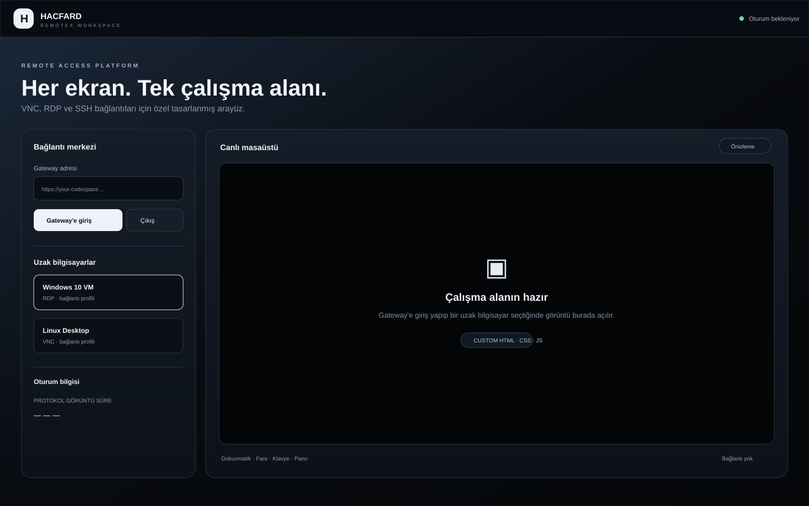

  
  <h1>Hacfard RemoteX</h1>
  
<strong>Custom remote desktop workspace · built by oldhacfard</strong>

  
Linux XFCE · Windows 10 QEMU · VNC · RDP · Mobile-first

---

## Overview

Hacfard RemoteX is a self-hostable remote desktop workspace with a custom HTML/CSS/JavaScript interface. Apache Guacamole and guacd proxy VNC/RDP sessions. The browser UI does not use the noVNC interface.

## Features

- Responsive black/white custom workspace.
- Linux XFCE desktop served over password-protected VNC.
- Experimental Windows 10 guest using QEMU and a QCOW2 virtual disk.
- Quick connection profiles for Linux VNC, Windows installation-console VNC, and Windows RDP.
- Guacamole authentication and WebSocket tunnel behind Nginx.
- Private Codespaces port 8080.

## Start in GitHub Codespaces

1. Open this repository in GitHub Codespaces using the included devcontainer.
2. Wait for server/bootstrap.sh to finish. It installs XFCE, TigerVNC, QEMU, Docker services, Guacamole, PostgreSQL, and Nginx.
3. Keep port **8080 private** and open the **RemoteX Custom UI** forwarded port.
4. Sign in to Guacamole. On a fresh database the initial account is normally **guacadmin / guacadmin**; change that password immediately.
5. In the RemoteX panel, select **Linux XFCE · VNC** and enter the Linux VNC password shown by the terminal command: cat ~/.config/hacfard-remotex/vnc-password
6. Click **Create connection**, then select the saved Linux connection.

## Windows 10 guest (experimental)

Windows is not automatically downloaded or licensed.

1. Upload your own licensed ISO to the Codespace as ~/Windows10.iso.
2. Run bash server/windows10-start.sh in the Codespaces terminal.
3. First boot creates a 64 GB QCOW2 disk and boots the Windows installer ISO.
4. Get the generated console password with cat ~/.config/hacfard-remotex/windows10-vnc-password.
5. In the RemoteX panel select **Windows 10 kurulum ekranı · VNC**, enter that password, and create the connection.
6. After installing Windows, later starts boot from the virtual disk. Enable Remote Desktop in Windows and create a strong Windows account password.
7. Select **Windows 10 masaüstü · RDP**, enter the Windows account password, and create the RDP connection.

Defaults are 2 vCPUs, 4 GB RAM and a dynamically allocated 64 GB disk. Set VM_CPUS, VM_MEMORY, and VM_DISK_SIZE before first start to change these values.

## VM limitations

- Codespaces is a development environment, not a dedicated VM host.
- Nested KVM may be unavailable. QEMU TCG software emulation can make Windows very slow or impractical.
- The Linux desktop is an XFCE session in the Codespace container, not a separate QEMU guest.
- Windows installation media and license are not included. Windows 10 standard support ended on 14 October 2025.
- Codespaces has usage limits and may stop when idle. This is not a guaranteed 24/7 VPS.

## Architecture

- remotex/index.html — custom client UI and connection creation.
- docker-compose.yml — Guacamole, guacd, PostgreSQL, Nginx.
- server/bootstrap.sh — first-time installation and startup.
- server/windows10-*.sh — QEMU Windows guest lifecycle.
- server/nginx.conf — same-origin API and WebSocket reverse proxy.

## Security

Keep forwarded port 8080 private. Do not forward 5901, 5902, 3389, or Guacamole's internal ports publicly. Do not commit passwords, Windows ISO files, VM disks, database credentials, or tokens. Change the default Guacamole password immediately.

## License

Use and modify this project for your own environment. Respect Microsoft Windows licensing and the licenses of bundled services.
